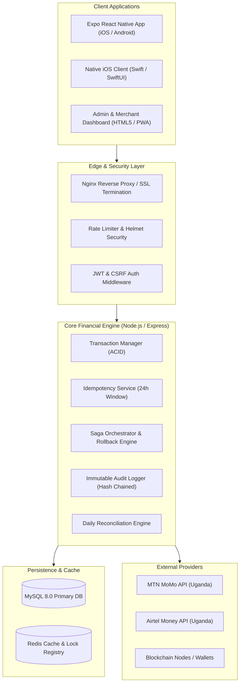

# GMG Fintech Platform

[](https://github.com/ssenkula-rivan/fintech/actions/workflows/ci.yml)
[](https://nodejs.org/)
[](https://opensource.org/licenses/MIT)
[](https://github.com/ssenkula-rivan/fintech)

Enterprise-grade mobile money, cross-border payments, and financial services platform designed for Uganda and East Africa. GMG provides seamless interoperability between telecom mobile money providers (MTN Mobile Money, Airtel Money), multi-currency fiat wallets (UGX, USD, EUR, GBP), and digital blockchain asset infrastructure.

---

## 🏛️ System Architecture



---

## 🚀 Key Modules & Capabilities

- **Telecom Mobile Money Gateway**: Native integration with MTN Uganda and Airtel Money for real-time collections, disbursements, and account balance queries.
- **Multi-Currency Wallets**: Real-time balance ledger supporting UGX, USD, EUR, GBP, KES, and RWF with automated exchange spread handling.
- **Transaction Integrity & ACID Engine**: Row-level locking (`SELECT FOR UPDATE`), multi-step rollback mechanisms, and two-phase commit (2PC) semantics for cross-system settlements.
- **Idempotency Safeguards**: Enforced client idempotency keys with 24-hour response caching to prevent duplicate debits.
- **Cryptographic Audit Trail**: Append-only audit logging linked with SHA-256 hash chains for tamper-evident compliance.
- **Crypto & Blockchain Services**: Non-custodial and custodial crypto wallet integrations for digital asset trading and settlements.
- **KYC & Regulatory Compliance**: Multi-tier KYC verification, identity document processing, and compliance reporting for Bank of Uganda regulations.
- **Cross-Platform Clients**: Modern React Native (Expo) mobile application, native SwiftUI iOS client, and responsive web portals.

---

## 📂 Repository Structure

```text
├── api/                        # Backend REST API (Node.js, Express, MySQL)
│   ├── config/                 # DB pool, environment validator & security configs
│   ├── middleware/             # Auth, CSRF, rate-limit, transaction & audit hooks
│   ├── migration/              # SQL schema migrations & seeders
│   ├── routes/                 # Financial endpoints (wallets, telecom, crypto, KYC)
│   ├── services/               # Core business services & payment integrations
│   ├── tests/                  # Unit and integration test suites
│   ├── database.sql            # Master database schema definitions
│   └── server.js               # Primary API server entrypoint
├── mobile/                     # React Native / Expo mobile application
│   ├── src/                    # Screens, navigation, store, and UI components
│   ├── app.json                # Expo application configuration
│   ├── eas.json                # Expo Application Services build configuration
│   └── App.tsx                 # Mobile app entry point
├── GMG/                        # Native iOS Application
│   ├── GMG.xcodeproj           # Xcode project configuration
│   └── GMG/                    # SwiftUI views and native assets
├── nginx/                      # Nginx reverse proxy configurations
├── docs/                       # Technical architecture & API documentation
├── .github/                    # CI/CD workflows and issue templates
│   ├── workflows/ci.yml        # Automated linting, test runner, and Docker build
│   └── ISSUE_TEMPLATE/         # Structured issue templates for tracking
├── docker-compose.yml          # Container orchestration (API, MySQL, Redis, Nginx)
├── TASKS_AND_ISSUES.md         # Production engineering tasks & issue tracker
└── scripts/                    # Automation scripts for deployment and issues
```

---

## 🛠️ Quick Start & Local Setup

### 1. Prerequisites
- [Node.js](https://nodejs.org/) (v18.x or v20.x recommended)
- [Docker](https://www.docker.com/) & Docker Compose
- [Expo CLI](https://docs.expo.dev/get-started/installation/) (for mobile development)

### 2. Environment Configuration
```bash
# Clone the repository
git clone https://github.com/ssenkula-rivan/fintech.git
cd fintech

# Create your local environment file from template
cp .env.example .env
# Edit .env and supply your local database credentials & secret keys
```

### 3. Run with Docker Compose
```bash
# Start all microservices (API, MySQL, Redis, Nginx)
docker-compose up -d

# Verify service health
docker-compose ps
```

The API will be available at `http://localhost:3010` and Nginx edge at `http://localhost:80`.

### 4. Running Backend Directly
```bash
cd api
npm install
npm run dev
```

### 5. Running the Mobile App
```bash
cd mobile
npm install
npx expo start
```

---

## 📋 Production Tasks & Issues Tracker

All engineering backlog items, architectural epics, and active tasks are tracked in detail in [TASKS_AND_ISSUES.md](file:///Volumes/cranictech/application/fin-app-main/TASKS_AND_ISSUES.md):

| Issue ID | Epic / Requirement | Priority | Status | Target Module |
|---|---|---|---|---|
| **#1** | [Transaction Lifecycle Management & State Machine](TASKS_AND_ISSUES.md#issue-1) | `P0 - Critical` | 🟢 In Progress | `api/services/transactionManager.js` |
| **#2** | [Database Transaction Integrity (ACID) & Row Locking](TASKS_AND_ISSUES.md#issue-2) | `P0 - Critical` | 🟢 In Progress | `api/services/dbTransaction.js` |
| **#3** | [Idempotency Service for Duplicate Prevention](TASKS_AND_ISSUES.md#issue-3) | `P0 - Critical` | 🟢 Active | `api/middleware/idempotency.js` |
| **#4** | [Audit Trail Logging with Cryptographic Hash Chain](TASKS_AND_ISSUES.md#issue-4) | `P0 - Critical` | 🟡 Pending | `api/services/auditLogger.js` |
| **#5** | [MTN & Airtel Payment Logging with PII Masking](TASKS_AND_ISSUES.md#issue-5) | `P1 - High` | 🟢 Active | `api/services/telecomPayment.js` |
| **#6** | [Automated Compensating Transactions & Rollback](TASKS_AND_ISSUES.md#issue-6) | `P1 - High` | 🟡 Planned | `api/services/compensate.js` |
| **#7** | [Distributed Saga Pattern Orchestration](TASKS_AND_ISSUES.md#issue-7) | `P1 - High` | 🟡 Planned | `api/services/sagaOrchestrator.js` |
| **#8** | [Referential Balance Integrity & Daily Reconciliation](TASKS_AND_ISSUES.md#issue-8) | `P0 - Critical` | 🟢 In Progress | `api/services/reconciliation.js` |
| **#9** | [Revenue, Fee & FX Conversion Spread Tracking](TASKS_AND_ISSUES.md#issue-9) | `P2 - Medium` | 🟢 Active | `api/routes/exchange.js` |
| **#10** | [Two-Phase Commit (2PC) Cross-System Protocol](TASKS_AND_ISSUES.md#issue-10) | `P1 - High` | 🟡 Planned | `api/services/twoPhaseCommit.js` |

To automatically publish these issues to your GitHub repository issue tracker, run:
```bash
GITHUB_TOKEN=your_personal_access_token ./scripts/create-github-issues.sh
```

---

## 🔒 Security & Compliance

- **No Secrets in Version Control**: `.env` and private keys are strictly git-ignored.
- **SQL Injection Prevention**: Prepared statements used for all SQL operations.
- **Financial Auditing**: Immutable audit records for every balance modification.
- **Data Protection**: PII data (phone numbers, National IDs, PINs) masked in telemetry.

---

## 📄 License
This project is licensed under the MIT License - see the LICENSE file for details.
